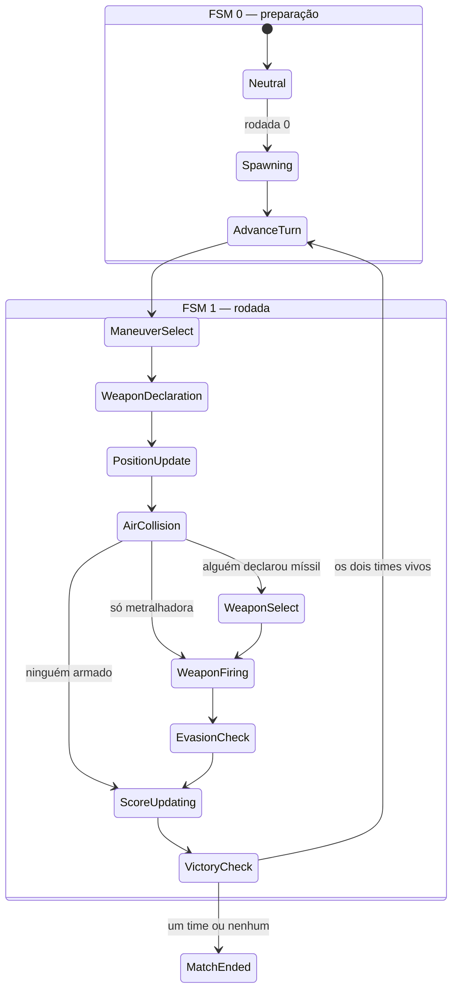

# FSM do tabuleiro — proposta

Data: 11/10/2026. Status: **proposta**, ainda sem código.

## A ideia central

No The Map Room a máquina de estados gira em torno do jogador: o turno é dele, ele age e o mundo reage. No Zone 5 ela gira em torno do **tabuleiro**: o tabuleiro tem fases, e o jogador é só um **contribuinte**. Ele entrega uma intenção (manobra, arma, trajetória) em 2 ou 3 passos e passa o resto do turno esperando a máquina resolver.

Consequências:

- **A rodada é do tabuleiro.** Não existe "vez do jogador" na lógica. O revezamento do hotseat é só apresentação: é o `panel_rodada` passando a vez dentro de um passo de coleta.
- **Coletar e resolver ficam separados.** Os passos de coleta só juntam intenções. Os passos da máquina resolvem tudo **ao mesmo tempo**, a partir de uma foto do tabuleiro.
- **O jogo é determinístico**, exceto pelo Evasion Check. Dado o tabuleiro e as intenções, o resultado é sempre o mesmo, e a sorte entra num único lugar. Isso é o que torna o debug (voltar, refazer, avaliar um a um) viável. A única outra fonte de sorte é a regra opcional de desmaio por fadiga de G, que usa o mesmo dado semeado.

## Diagrama



## Os passos

Legenda: **coleta** = os jogadores contribuem; **máquina** = sem intervenção humana.

| # | Passo | Tipo | Progresso | Pula quando |
|---|---|---|---|---|
| 0.0 | Neutral | máquina | — | — |
| 0.1 | Spawning | máquina | oculto | — |
| 0.2 | Advance Turn | máquina | — | — |
| 1.1 | Maneuver Select | **coleta** | visível `k/N` (vivos) | — |
| 1.2 | Weapon Declaration | **coleta** | visível `k/N` (vivos) | — |
| 1.3 | Position Update | máquina | oculto | — |
| 1.4 | Air Collision | máquina | — | nenhuma colisão (passa direto, sem pausa) |
| 1.5 | Weapon Select | **coleta** | visível `k/M` (só quem declarou míssil) | ninguém declarou míssil |
| 1.6 | Weapon Firing | máquina | oculto | ninguém declarou arma |
| 1.7 | Evasion Check | máquina | oculto | nenhum alvo marcado |
| 1.8 | Score Updating | máquina | — | — |
| 1.9 | Victory Check | máquina | — | — |

### Coleta: hotseat e online

Os três passos de coleta (Maneuver Select, Weapon Declaration e Weapon Select) funcionam igual para a FSM: ela só enxerga `k/N` e o prazo. O que muda com o modo da sessão é **como os jogadores entram** e **como o tempo corre**.

**Quem controla cada slot**, e como isso define o modo:

| Controle | O que é |
|---|---|
| `Human/Local` | humano nesta máquina |
| `Human/Remote` | humano em outra máquina, conectado ao host |
| `AI` | IA, que roda no host |

| Modo | Composição dos slots | Coleta |
|---|---|---|
| **Online** | **exatamente 1** `Human/Local`, que é o **host**; os demais são `Human/Remote` ou `AI` | todos em paralelo, prazo único sincronizado |
| **Hotseat** | 2 ou mais `Human/Local`, mais `AI` opcional; nenhum `Human/Remote` | humanos em sequência; IA em paralelo |
| **Solo contra IA** | 1 `Human/Local` e o resto `AI` | todos em paralelo, igual ao online sem rede |

- O modo **não é escolhido**: ele sai da composição dos slots.
- A existência de algum `Human/Remote` é o que define o online.
- **Online com mais de 1 `Human/Local` é inválido.** É o hotseat híbrido proibido, e o `PartidaConfig.Validate` tem que recusar.

Exemplo online:

```
slot 0: Human/Local (host)
slot 1: Human/Remote
slot 2: AI
slot 3: AI

Maneuver Select — tempo corrido, sincronizado
slot 0: escolhendo — 30 s
slot 1: escolhendo — 30 s
slot 2: escolhendo — 30 s
slot 3: escolhendo — 30 s
```

| | **Online** (1 jogador por máquina) | **Hotseat** (1 máquina, todos na sala) |
|---|---|---|
| Quem escolhe | todos ao mesmo tempo, em paralelo | um por vez, em sequência por slot (0, 1, 2...) |
| Tempo | **um prazo só**, 30 s, correndo para todos em sincronia | **30 s por jogador**, que só começam a correr na vez dele |
| Duração máxima do passo | 30 s | N × 30 s |
| `panel_rodada` | não existe | abre para o jogador da vez e funciona como cortina de privacidade entre um jogador e o próximo |
| Quem estourou o tempo | recebe o padrão (1G09, "nada"...) | recebe o padrão, e a vez passa para o próximo |

Online, cada slot aparece como *escolhendo* ou *enviou*:

```
Maneuver Select — 30 s, sincronizado
slot 0: escolhendo
slot 1: enviou manobra
slot 2: enviou manobra
slot 3: escolhendo
```

No hotseat, um slot está *escolhendo*, os anteriores *enviaram* e os seguintes estão *aguardando*:

```
Maneuver Select
slot 0: manobra enviada
slot 1: escolhendo — 30 s correndo para ele
slot 2: aguardando...
slot 3: aguardando...
```

**Slots de IA.** A IA preenche slots vazios, e **para ela o tempo é sempre de 30 s em paralelo, independente do modo**. No hotseat local, ela escolhe ao mesmo tempo que a fila de humanos:

```
Slots: Human/Local, Human/Local, AI, AI

Maneuver Select
slot 0: escolhendo — 30 s correndo para ele
slot 1: aguardando...
AI/slot 2: escolhendo — 30 s, tempo corrido
AI/slot 3: escolhendo — 30 s, tempo corrido
```

- **A IA decide a partir da foto do tabuleiro** tirada no início do passo e **nunca lê as intenções já enviadas pelos outros**. No hotseat ela roda na mesma máquina e teria acesso a elas. O isolamento tem que estar no código, porque a cortina não protege da IA.
- **Os 30 s são um teto, não um tempo de pensar.** A IA pode responder na hora. Se a resposta vier rápido demais, um pequeno atraso só para efeito visual é opcional. Se ela estourar o prazo, recebe o mesmo padrão dos humanos (1G09, "nada"...).
- **O `panel_rodada` nunca abre para um slot de IA.** A fila do hotseat pula os slots de IA.
- **A duração do passo no hotseat** passa a ser o maior valor entre a fila de humanos (H × 30 s) e a janela da IA (30 s). Com 2 humanos e 2 IAs, são até 60 s.
- **Online, a IA roda no host**, como um participante a mais dentro do prazo sincronizado.
- **O status da IA mostra só se ela "enviou"**, nunca o que escolheu, como acontece com os humanos.
- **No `PartidaConfig`,** cada slot ocupado precisa dizer quem o controla: `Human/Local`, `Human/Remote` ou `AI`. Hoje o slot só tem `Empty`/`Occupied`.
- **Ainda não existe IA no Zone 5.** Para a FSM, o slot de IA é só um participante paralelo com prazo; a IA em si é outra frente de trabalho. Enquanto ela não existir, um slot de IA pode usar uma escolha fixa ou aleatória (o 1G09 e o "nada", ou uma manobra válida qualquer), o que já serve para testar a FSM.

- **O tempo é opcional.** Com o tempo em 0, o passo espera indefinidamente, que é o modo MVP sem relógio.
- **A ordem por slot não vaza informação.** Com a cortina, quem escolhe depois não vê a escolha de quem veio antes.
- **Hotseat híbrido é proibido**, ou seja, dois humanos numa máquina jogando contra outros em outras máquinas. Os relógios não fecham: ou a máquina com 2 jogadores tem 15 s para cada um enquanto os outros têm 30 s, ou cada um tem 30 s e todos esperam 60 s por aquela máquina. No multiplayer é sempre 1 jogador por máquina.
- **Online, quem manda no relógio é o servidor (host).** O prazo dos clientes é só exibição; o que vale é o deadline do host.

### FSM 0 — preparação

**Neutral.** Recálculos e preparativos. É o estado de repouso entre dois passos: nada está animando e nada é provisório. Todo estado derivado do tabuleiro (HUD, painel tático, cones de mira) se recalcula **aqui**. Esta regra vem do Map Room, onde o mundo só recalcula no Neutral.

**Spawning (rodada 0).** Lê o `PartidaConfig` e coloca EUA à esquerda e URSS à direita, em **formação diamante**, sem intervenção humana. A ordem de entrada no diamante, conforme `docs/outros/Zone 5 - Air Combat rules.md`: 1) nariz, 2) ala esquerda, 3) ala direita, 4) centro; depois segunda ala esquerda, segunda ala direita, e assim por diante. A distância inicial entre os times é de **4 comprimentos de míssil**.

**Advance Turn.** Incrementa a rodada (0 → 1 na primeira vez), limpa as intenções da rodada anterior, os marcadores temporários e os mísseis, e abre o Maneuver Select.

### FSM 1 — a rodada

**1.1 Maneuver Select (coleta).** Um subpasso por slot vivo. Com 2 contra 2, o progresso vai de 0/4 a 4/4.
- Cada jogador escolhe uma manobra e envia; o progresso avança e ele aguarda os outros.
- Quem estoura o tempo recebe **1G09** automaticamente.
- Como os jogadores entram no passo depende do modo da sessão; ver [Coleta: hotseat e online](#coleta-hotseat-e-online).
- Se aplicam aqui as restrições de quem tomou dano de metralhadora (menos opções de velocidade e de manobra).

**1.2 Weapon Declaration (coleta).** Também por slot, de 0/N a N/N. As opções são:
- **míssil**, se ainda houver mísseis;
- **metralhadora**, com 4 cargas por partida e 1 gasta por disparo. É um limite de tiro: sem ele, todo mundo atiraria toda rodada só para "escanear de graça" onde dá para mandar um míssil;
- **nada**.

Quem estoura o tempo envia "nada". A declaração é **antes** do movimento: o jogador se compromete com a arma sem saber onde vai parar.

**1.3 Position Update (máquina).** Move todos ao mesmo tempo para as novas posições, cada um pela trajetória da sua manobra. As aeronaves que colidiram são **marcadas** para destruição, mas não são destruídas ainda. O progresso existe, mas é interno e oculto.

A colisão só olha **instantes**, e não o caminho:
- Cada aeronave ocupa **pontos no tempo**: a posição final de cada carta. Isso dá um ponto normalmente e dois no After-Burner (pos 1 e pos 2).
- Duas aeronaves colidem quando algum ponto de uma se sobrepõe a algum ponto da outra. No After-Burner valem as duas posições: é como bater numa moto em alta velocidade num instante de tempo.
- **Não há colisão pelo rastro.** Ficar entre a pos 1 e a pos 2 de um caça em After-Burner é estar "no vácuo" dele, e não conta como colisão.

**1.4 Air Collision (máquina).** Os jogadores veem as aeronaves marcadas explodindo e saindo do jogo. É só apresentação: a decisão já foi tomada no 1.3.
- **A colisão vem antes do disparo, de propósito.** Quem colidiu sai do jogo antes do Weapon Select: não atira e não é alvo. Assim não tem a salada de duas aeronaves colidindo e um míssil ainda chegando na festa. No After-Burner, colidir na pos 1 também tira o avião antes do disparo.
- **Ninguém pontua na colisão**, e ela vale também entre aviões do mesmo time. Com manobras secretas e simultâneas, colisão é quase sempre acidente. Se contasse como abate, virava tática: jogar um avião em cima do adversário seria uma troca boa. A colisão aparece na tabela de pilotos como estatística, sem pontos. *Regra opcional do contrato:* "colisão conta como abate mútuo" (o "splash 1 for both guys" do DCS).

**1.5 Weapon Select (coleta).** Só participa quem declarou míssil. Com 2 contra 2, fica tipicamente em 0/3 ou 0/2.
- Quem declarou metralhadora fica **em hold**: não escolhe nada, porque a metralhadora atira reto.
- Quem declarou "nada" está fora.
- O jogador escolhe, entre os mísseis e trajetórias que lhe restam, a que acha que acerta o alvo dentro do cone de mira, e envia.
- O passo é pulado quando ninguém declarou míssil.

**1.6 Weapon Firing (máquina).** Todos atiram ao mesmo tempo, mísseis e metralhadoras, com animação e som. O progresso é oculto.
- **Quem fez After-Burner atira da pos 2**, a posição final; a pos 1 é só alvo.
- **Só o primeiro alvo da trajetória conta.** O "tiro oportunista", em que o projétil continua e atinge outros, fica como opção de jogo e vem desligado no MVP.
- **Mísseis não colidem** entre si nem com as trajetórias uns dos outros.
- As opções de jogo são fogo amigo (liga/desliga) e a **dificuldade da detecção de impacto**:
  - **Difícil:** o desenho do míssil tem que encostar na fuselagem ou passar por cima dela (colisão exata).
  - **Fácil:** o míssil pode passar do lado e ainda pegar. Isso emula a espoleta de proximidade: na vida real o míssil não acerta o caça, ele explode perto, e a onda de choque rasga a fuselagem. O tamanho da tolerância é um parâmetro; hoje existe o `extendedTrailHitboxTolerance` no `DebugManager`.
  - A metralhadora usa sempre a colisão exata.
- **Só marca.** Cada aeronave potencialmente atingida recebe um marcador com quem atirou e com qual arma. Nenhum dano é calculado aqui.

**1.7 Evasion Check (máquina).** É **o único passo com sorte**. Para cada aeronave marcada, há uma rolagem de esquiva **por atirador**, todas ao mesmo tempo. Por isso duas aeronaves podem se destruir mutuamente com mísseis. As regras estão em [Esquiva, dano e abate](#esquiva-dano-e-abate).

**1.8 Score Updating (máquina).**
- Atualiza a tabela de abates, assistências e pontos, pelas regras de [Quem leva o abate](#quem-leva-o-abate) e [Pontuação](#pontuação).
- Atualiza o status dos slots. Quem tomou dano de metralhadora e continua no ar fica com restrições de manobra.
- Remove as aeronaves abatidas.

**1.9 Victory Check (máquina).** Se um dos times ficou sem aeronaves, o outro vence. Se os dois ficaram vazios na mesma rodada, é empate. Com os dois times vivos, volta para o Advance Turn.

> A descrição original colocava "avança a rodada" dentro do Score Updating, antes do Victory Check. Aqui o avanço vira um passo à parte (**Advance Turn**), **depois** do Victory Check, para não abrir uma rodada nova numa partida que já acabou.

## Esquiva, dano e abate

### Quantos testes: depende da manobra

O número de testes de esquiva sai da **manobra que a aeronave executou** (`ManeuverProfile.evasionPenalty`, de 0 a 3). **Mais testes significa mais chance de morrer.**

| Categoria (stance) | Descrição | Testes | Exemplos |
|---|---|---|---|
| Flying | voo reto e curvas | 2 a 3 | 1G09 (3), 3G18 (2) |
| After-Burner | duas cartas combinadas, 1G e/ou 3G | 2 a 3 **por posição** | 1G09 (3) + 1G09 (3) |
| Low Acrobatics | acrobacias até 6G | 1 a 3 | Split-S (1), Half Loop lento (3), Looping (2) |
| High Acrobatics | acrobacias de 7G a 9G | 0 a 3 | Immelmann (3), Tesoura Direita (1), Parafuso (**0 = esquiva automática**) |

**After-Burner: duas cartas, dois pontos de mira.** Fazer After-Burner é jogar duas cartas no mesmo turno.
- **A vantagem** é o deslocamento longo.
- **A desvantagem** é que a aeronave fica exposta em **dois** pontos: o fim de cada carta.

No Position Update ela "para lá na frente", na pos 2, mas deixa para trás uma **sombra** na pos 1. As duas são alvos no Weapon Firing.

```
[início] ──carta 1──▶ [pos 1] ──carta 2──▶ [pos 2]
                         ▲                     ▲
           um oponente voando perpendicular pode alvejar a pos 1 ou a pos 2
```

- **As cartas se encaixam.** Cada carta tem um encaixe de saída na traseira e um de chegada no nariz, e a carta 2 começa exatamente no encaixe de chegada da carta 1, com o mesmo rumo. A pos 1 é esse ponto de encaixe. É o mesmo mecanismo que já liga uma rodada à seguinte: o `MatchControllerMvp` guarda o fim da trajetória (`lastEndByUnit`, a partir do `ExhaustAnchor`) e começa a próxima ali. O After-Burner só aplica o encaixe duas vezes na mesma rodada.
- Quem é pego na pos 1 testa com os testes **da carta 1**; quem é pego na pos 2, com os **da carta 2**.
- Os testes **não somam**. Com 3G18 (2) + 3G18 (2), um míssil que pega a pos 1 gera **um** teste com 2 dados, não com 4.
- Cada disparo continua pegando só o primeiro alvo da sua trajetória: a pos 1 **ou** a pos 2, nunca as duas.
- Atiradores diferentes podem pegar pontos diferentes, cada um com o seu teste. Voando reto em After-Burner, dá para levar dois mísseis na fuça: um na pos 1 e outro na pos 2.
- Os dois pontos são alvos para qualquer arma, míssil ou metralhadora.

### Cada teste

- **d4:** 3 ou 4 esquiva, 1 ou 2 falha. Isso equivale a um d2 (50%). A lógica pode rolar d2 e a apresentação mostrar d4, se você quiser o "sabor" do dado.
- Os sucessos e as falhas são **contados**, como nos dados do Storytelling. O que importa para o dano são as falhas.
- **0 testes = esquiva automática.**

### Dano

| Arma | Dano por falha | Leitura |
|---|---|---|
| Míssil | **3 HP** | Como o HP inicial é 3, **basta 1 falha para morrer**. |
| Metralhadora | **1 HP** | É uma "aeronave atingida", e o dano vai se acumulando. |

**Alcance da metralhadora:** exatamente **metade do míssil reto** (o #1 do catálogo, `M10F`). Hoje o míssil voa 10 FU (`Long Range.asset`, `rangeFU: 10`), então a metralhadora alcança 5 FU, em linha reta à frente.

**Animação da metralhadora:** não pode ser um míssil. Tem que ser vários risquinhos voando; o visual ainda vai ser inventado.

*(Unidade: o que se fala como "PU" é o FU do código.)*

O dano de cada atirador é calculado **separadamente** e depois somado. Exemplo: Dimitri, numa 3G lenta (3 testes), alvo de três mísseis.

```
vs Maverick (míssil)  S S F  → 3 HP
vs Iceman   (míssil)  S F F  → 6 HP
vs Slider   (míssil)  S S S  → 0 HP
→ Dimitri abatido por Iceman (6 HP, o maior dano); Maverick assistência; Slider fora (não causou dano)
```

### Avarias: o dano que não mata

Só a metralhadora deixa uma aeronave viva com dano, porque qualquer falha de míssil já tira 3 HP. As avarias são **cumulativas**:

| Dano acumulado | Avaria | Efeito nas rodadas seguintes |
|---|---|---|
| 1 HP | **Fuselagem avariada** | Deck de manobras limitado a 6G. |
| 2 HP | **Avarias na turbina** | Velocidade máxima 0,9 e After-Burner proibido. |
| 3 HP | Abatido | — |

Exemplo: Dimitri leva 1 HP da metralhadora de Maverick e 1 de Iceman, e esquiva de Slider. Total de 2 HP: ele não cai, mas fica com as **duas** avarias.

O Maneuver Select e o painel de cartas precisam esconder ou bloquear as opções que a avaria proíbe.

### Quem leva o abate

Só se aplica quando o dano somado de todos os atiradores, em todas as posições, chega ao HP da aeronave.

**Se nenhum míssil causou dano** (só metralhadoras):
1. **Posição:** quem pegou primeiro. A pos 1 vem antes da pos 2.
2. **Dano:** quem causou mais dano.
3. **Empate:** todos os empatados levam o ponto de abate.

**Se algum míssil causou dano, o míssil sempre leva vantagem:**
1. O abate é do melhor atirador de míssil: primeiro a **posição** (pos 1 antes da pos 2), depois o **dano**. Se empatar, todos os empatados levam o ponto.
2. A metralhadora não disputa, **mesmo que várias metralhadoras somem juntas dano letal**.
3. **Exceção, a metralhadora que "vira um míssil":** um atirador de metralhadora cujo dano **sozinho** chega ao HP, **na mesma posição ou numa anterior** à do míssil vencedor, também leva o ponto de abate (empate). Se houver mais de uma metralhadora assim, todas entram no empate.

Sem After-Burner só existe uma posição, e a posição não decide nada.

Todo contribuinte que causou dano e não levou o abate fica com **assistência**. O dano "a mais" (overkill) também conta para a assistência. Quem não causou dano não leva nada.

**Exemplo completo.** Dimitri em After-Burner. Na notação, H é acerto (falha na esquiva) e F é esquiva.

| Atirador | Arma | Pos 1 | Pos 2 | Abate | Assistência |
|---|---|---|---|---|---|
| Maverick | míssil | F,F,H → 3 HP | | **x** | |
| Iceman | míssil | | F,H,H → 6 HP | | x |
| Slider | metralhadora | F,H,H → 2 HP | | | x |
| Wolfman | metralhadora | | F,F,F → 0 HP | | |

Dimitri leva 11 HP no total e morre. Houve míssil, então só os mísseis disputam: Maverick acertou a pos 1 e Iceman a pos 2, e a posição decide antes do dano. O abate é de **Maverick**, mesmo Iceman tendo causado mais dano (6 HP). A metralhadora de Slider (2 HP) não é letal sozinha, então não entra no empate. Iceman e Slider ficam com assistência, e Wolfman, que não causou dano, fica sem nada.

**Exemplo com uma posição só.** Dimitri em voo simples (2 testes).

| Atirador | Arma | Pos 1 | Abate | Assistência |
|---|---|---|---|---|
| Maverick | metralhadora | F,H → 1 HP | | x |
| Iceman | míssil | H,H → 6 HP | **x** | |
| Slider | metralhadora | H,H → 2 HP | | x |
| Wolfman | metralhadora | F,F → 0 HP | | |

Dimitri leva 9 HP no total e morre. **O míssil sempre leva vantagem sobre a metralhadora**: o abate é de **Iceman**, mesmo Maverick e Slider tendo causado juntos, só de metralhadora, dano suficiente para abater (3 HP).

Outro caso, só com a posição final e três mísseis: Maverick causa 3 HP, Iceman 6 HP e Slider 0. O abate é de **Iceman**, e Maverick fica com assistência.

**Só metralhadoras: o abate coletivo.** Dimitri em voo simples (2 testes).

| Atirador | Arma | Pos 1 | Abate | Assistência |
|---|---|---|---|---|
| Maverick | metralhadora | F,H → 1 HP | **x** | |
| Iceman | metralhadora | F,H → 1 HP | **x** | |
| Slider | metralhadora | F,H → 1 HP | **x** | |
| Wolfman | metralhadora | F,F → 0 HP | | |

São 3 HP no total, e Dimitri morre. Os três empatam em posição, arma e dano, então **os três levam o ponto de abate**.

**Só metralhadoras, com um destaque.** Mesma situação, mas Slider acerta H,H.

| Atirador | Arma | Pos 1 | Abate | Assistência |
|---|---|---|---|---|
| Maverick | metralhadora | F,H → 1 HP | | x |
| Iceman | metralhadora | F,H → 1 HP | | x |
| Slider | metralhadora | H,H → 2 HP | **x** | |
| Wolfman | metralhadora | F,F → 0 HP | | |

São 4 HP no total. Slider causou mais dano e leva o abate sozinho; Maverick e Iceman ficam com assistência.

**Metralhadoras na pos 1, míssil na pos 2, nenhuma metralhadora letal sozinha.** Dimitri (2 testes).

| Atirador | Arma | Pos 1 | Pos 2 | Abate | Assistência |
|---|---|---|---|---|---|
| Maverick | metralhadora | F,H → 1 HP | | | x |
| Iceman | metralhadora | F,H → 1 HP | | | x |
| Slider | metralhadora | F,H → 1 HP | | | x |
| Wolfman | míssil | | F,H → 3 HP | **x** | |

As três metralhadoras somam 3 HP na pos 1, mas **nenhuma é letal sozinha**. O abate é só de **Wolfman**, e os três ficam com assistência.

**Uma metralhadora letal sozinha na pos 1, míssil na pos 2.** Dimitri (3 testes).

| Atirador | Arma | Pos 1 | Pos 2 | Abate | Assistência |
|---|---|---|---|---|---|
| Maverick | metralhadora | H,H,H → 3 HP | | **x** | |
| Iceman | metralhadora | F,F,H → 1 HP | | | x |
| Slider | metralhadora | F,H,H → 2 HP | | | x |
| Wolfman | míssil | | F,H,F → 3 HP | **x** | |

Maverick derrubou Dimitri sozinho na pos 1: a metralhadora dele "virou um míssil". **Empate entre Maverick e Wolfman**, e os dois levam o ponto de abate. Iceman e Slider ficam com assistência.

Decidido em 11/10/2026.

**Mesma posição: mísseis empatados e uma metralhadora letal sozinha.** Dimitri em voo simples (3 testes).

| Atirador | Arma | Pos 1 | Abate | Assistência | Pontos |
|---|---|---|---|---|---|
| Maverick | metralhadora | H,H,H → 3 HP | **x** | | 0,30 |
| Iceman | míssil | H,F,F → 3 HP | **x** | | 0,30 |
| Slider | metralhadora | F,F,H → 1 HP | | x | 0,10 |
| Wolfman | míssil | F,F,H → 3 HP | **x** | | 0,30 |

Iceman e Wolfman empatam no míssil (pos 1, 3 HP). Maverick é letal sozinho na mesma posição, então "vira um míssil" e entra no empate. Slider fica com assistência. A coluna Pontos está explicada em [Pontuação](#pontuação).

### Pontuação

Cada aeronave derrubada distribui **exatamente 1 ponto** entre quem participou, por média ponderada:

```
peso do abate = 3      peso da assistência = 1
ponto do participante = peso dele / soma dos pesos de todos os participantes
```

No exemplo acima: 3 abates × 3 + 1 assistência × 1 = 10. Cada abate vale 3/10 = **0,30**, e a assistência 1/10 = **0,10**.

- **No painel, em jogo,** aparecem os contadores **inteiros**: abates e assistências. É o que se lê rápido.
- **No ranking,** valem os **Pontos**. Assim quem dividiu um abate com mais dois não vale o mesmo que quem derrubou sozinho.
- **Os pesos são parâmetros.** Com o peso da assistência em 0, vira a divisão igual entre quem abateu (0,33 cada), e a assistência não pontua.

### Tabela de pilotos

Além do placar da partida, cada piloto (identificado pelo callsign) acumula estatísticas entre partidas:

| Coluna | O que conta |
|---|---|
| Surtidas | partidas jogadas |
| Vitórias / Empates / Derrotas | resultado do time |
| Abates | pontos de abate, inclusive os divididos no empate |
| Assistências | |
| Pontos | a soma dos pontos ponderados (1 por queda) |
| Abates em sequência | maior número de abates seguidos sem morrer |
| Mortes | abatido, colisão, pane seca ou abandono |
| K/D | abates ÷ mortes |
| **Abandonos** | saídas pela borda: o demérito |
| Colisões | só estatística, sem pontos |
| Panes secas | quedas por combustível |

- Pane seca e abandono **não dão ponto a ninguém**, mas contam como morte de quem caiu ou saiu.
- Guardar a tabela entre partidas exige salvar dados localmente, como o `SaveGameManager` do Map Room. Isso fica para depois do MVP e conversa com o futuro modo carreira.

### O tabuleiro

- **Retangular ou quadrado, sem grid:** nada de tilemap, nem hexagonal nem quadrado.
- **Tamanho fixo no MVP.**
- **Depois,** pode ser projetado por fora com tamanhos variados, como o modo campanha e o mundo Fixture do Map Room.
- A distância inicial entre os times (4 comprimentos de míssil) e a regra da borda usam o retângulo do tabuleiro da partida. Hoje o `CameraManager` já usa um collider ou um renderer como limite da câmera; o mesmo objeto pode servir de borda do tabuleiro.

## Notação das manobras

**A alavanca de velocidade tem 4 posições:** 0,6, 0,9, 1,2 e 1,8. A carta marca uma delas com uma seta, e o código traz a posição marcada (`06`, `09`, `12`, `18`). No código é o enum `ManeuverProfile.Mach` (`M06`, `M09`, `M12`, `M18`). São as 4 velocidades que geram os degraus da tabela de combustível.

O código da manobra traz o G, a categoria, a velocidade e a direção: `7A09D` = 7G, **A**crobacia, M09, para a **D**ireita.

- **G** é manobra normal (Flying), e **A** é acrobacia (Low ou High).
- A letra é o que separa duas manobras com o mesmo G, velocidade e direção:
  - `7G09D` é a **curva fechada para a direita feita devagar**;
  - `7A09D` é o **Immelmann** para a direita, a meia-volta em U invertido (`7A09E` para a esquerda). Só existe em M09.
- O Split-S é `3A`. O código `3G` também é aceito, como apelido.
- Como os códigos podem confundir o jogador, a carta deve mostrar primeiro o **nome** e o **desenho da trajetória**, e o código em segundo plano.

### As 15 acrobacias

São 15 cartas de acrobacia. O código segue a notação A, com a velocidade marcada na alavanca da carta. Os testes de esquiva são os ícones amarelos no canto inferior esquerdo.

| G | Nome | Cartas | Código proposto | Velocidade | Testes | Faixa | Obs |
|---|---|---|---|---|---|---|---|
| 0G | Air Brake | 1 | `0A06` | 0,6 (doc antigo) | 3 | Low | Um truque: o avião parece parar no ar. O piloto pisa no freio, o avião sobe um pouco e volta ao normal no fim do movimento. |
| 2G | Tunneou | 2 (D, E) | `2A09D`, `2A09E` | 0,9 (doc antigo) | 1 | Low | |
| 3G | Split-S | 1 | `3A09` (aceita `3A` e `3G`) | 0,9 (doc antigo) | 1 | Low | Gira no eixo, em linha reta. |
| 5G | Half Loop | 4 | `5A09D`, `5A09E`, `5A12D`, `5A12E` | 0,9 e 1,2 | 09: 2 · 12: 1 | Low | As bolinhas da carta mostram a velocidade. |
| 6G | Looping | 1 | `6A09` | 0,9 | 2 | Low | Na carta parece um avanço, mas a intenção é um **looping para trás**: deformação maior no eixo X, o avião vira e volta algumas casas. |
| 7G | Immelmann | 2 (D, E) | `7A09D`, `7A09E` | 0,9 | 3 | High | A meia-volta de 180°. É a carta usada pela regra da borda. |
| 8G | Tesoura | 2 (D, E) | `8A09D`, `8A09E` | 0,9 | 1 | High | |
| 9G | Parafuso | 2 (D, E) | `9A12D`, `9A12E` | 1,2 | 0 | High | Esquiva automática. |

- **Low** vai até 6G, e **High** de 7G a 9G.
- As 15 entram na regra de **1 uso por código por batalha**.
- As velocidades marcadas "doc antigo" vêm de `docs/outros/manobras.md`.
- Todo código traz a velocidade (`6A09`, `8A09D`), como nas manobras normais (`1G09`). As formas curtas (`3A`, `3G`) ficam como apelidos.
- **Acrobacias são de uso único, inclusive o Air Brake e o Tunneou.** Decidido.

### O perfil lateral e a "sensação de 3D"

O jogo é 2D, visto de cima, mas cada carta traz no canto superior esquerdo um **desenho do perfil lateral** da manobra, que mostra o que acontece na altitude. Exemplos:
- o Air Brake é uma linha reta com um degrau: sobe um pouco e volta;
- o Half Loop é um U: sobe, passa por cima e volta invertido.

Esse perfil é a **chave do desenho da manobra**. Ele define como a figurinha do avião se distorce ao longo do caminho:
- **encurta** quando o nariz aponta para cima ou para longe (o escorço);
- **vira** no topo do loop;
- **volta ao tamanho normal** no fim, já no rumo novo.

O avião sempre termina a manobra na pose normal.

- **No código, a base já existe:** o `ManeuverProfile` tem quadros-chave de deformação ao longo do progresso (`VfxKeyProgress`: `rollXDeg`, `rollYDeg`, `scale`), e o `AircraftView` os aplica durante a animação. O 7G12D, por exemplo, já tem a rolagem ajustada.
- **Ferramenta futura, dentro do jogo:** desenhar o perfil lateral e gerar a partir dele os quadros-chave de deformação. Isso entra junto com as ferramentas de manutenção da base.

## Recursos e limites por batalha

Estas regras impedem o spam sem proibir manobra nenhuma. As opcionais entram no **contrato da partida** (`PartidaConfig`) na hora de abrir a sala; no online, o host manda as regras junto com a partida.

| Regra | Status | Como funciona |
|---|---|---|
| **Acrobacia: 1 uso por código por batalha** | decidido | Cada código de acrobacia (High e Low) pode ser enviado **uma vez por batalha**. Exemplo: o Parafuso `9A12E` uma vez e o `9A12D` uma vez. O uso regenera na batalha seguinte, porque o corpo humano não aguenta. O deck do Maneuver Select esconde ou bloqueia o código já usado. |
| **9G só em M12** | decidido | O 9G (Parafuso) existe só como `9A12D` e `9A12E`. Não existe em outras velocidades. Vale 0 testes de esquiva, ou seja, esquiva automática. |
| **After-Burner só com 1G e 3G da categoria Flying** | decidido | Duas cartas por rodada, nunca acrobacia, no máximo 3G (regras originais). |
| **Combustível** | decidido (tabela abaixo) | O consumo depende da **velocidade total** da rodada (a soma das cartas), e não do G nem da direção. Assim `1G18`+`3G18E`, `3G18D`+`3G18D` e `1G18`+`1G18` consomem igual. O tanque é de 40 (`UnitProfile.maxFuel`). **O gasto é provisório** até o Position Update, como no Map Room: o preview do Maneuver Select mostra quanto vai sobrar, e o tanque só é debitado quando a rodada se confirma. **Tanque vazio:** naquela rodada o avião plana em 1G09 forçado e, no fim dela, cai e é eliminado. Essa rodada é a **única chance** de alguém abatê-lo. Se ele for abatido, o abate é pontuado normalmente; se cair por falta de combustível, **ninguém pontua**. Hoje nada consome combustível. |
| **Fadiga de G** | opcional (realismo) | Um medidor por piloto: cada manobra soma o G dela, e o corpo recupera X por rodada. Acima do limite há **chance de desmaio**. Quem desmaia entra em apagão na rodada seguinte: a manobra é forçada para 1G09 e ele não atira, ficando reto e exposto, com 3 testes de esquiva. No futuro modo carreira, veteranos aguentam mais G e se recuperam melhor. Os números ainda são a definir. |
| **Borda do tabuleiro** | decidido | A checagem usa sempre a **posição projetada**: o "quadrado fantasma" que o preview do Maneuver Select mostra antes de o jogador confirmar. Se a manobra (ou o conjunto do After-Burner: só a pos 2 final é checada, e se vazar troca tudo) termina fora do tabuleiro, a jogada inteira é **trocada por um Immelmann** sorteado entre os que o jogador ainda não usou. Só existem dois, `7A09E` e `7A09D`: 7G, velocidade 0,9, 3 testes de esquiva, saindo pela esquerda ou pela direita; e a declaração de arma da rodada é **cancelada**: ele não atira. **O jogador é avisado no Maneuver Select, antes de confirmar**, assim que o quadrado fantasma vaza: "essa jogada vai tirar você do tabuleiro; vamos usar o `7A09E` para trazer você de volta". O Immelmann já sorteado aparece no aviso, e o uso dele é consumido. Se só restar um, o aviso mostra esse. Se não restar nenhum, o aviso diz "você vai ser eliminado do jogo". Se não sobrar nenhum Immelmann, o jogador **sai da zona de engajamento** e é desqualificado e removido, por abandonar a luta. **Ninguém pontua** pela saída, e ela conta como **abandono** na tabela de pilotos. O Immelmann foi escolhido em vez do Half Loop porque inverte o avião 180°; o Half Loop faz ângulos diagonais que podem jogá-lo para outra borda. |
| **Cargas da metralhadora** | decidido | 4 por partida, 1 por disparo. |

### Tabela de combustível

O consumo é a **posição da velocidade total na escala de velocidades possíveis**, e não uma fórmula. As velocidades totais que existem (uma carta só, ou a soma das duas do After-Burner) são ordenadas, e cada degrau consome 1 a mais. Vale para 1G, 3G ou a mistura dos dois; a ordem das cartas não importa.

| Velocidade total | Combinações | Consumo |
|---|---|---|
| 0,6 | 1G06 | 1 |
| 0,9 | 1G09 | 2 |
| 1,2 | 1G12 · 1G06+1G06 | 3 |
| 1,5 | 1G06+1G09 | 4 |
| 1,8 | 1G18 · 1G06+1G12 · 1G09+1G09 | 5 |
| 2,1 | 1G09+1G12 | 6 |
| 2,4 | 1G06+1G18 · 1G12+1G12 | 7 |
| 2,7 | 1G09+1G18 | 8 |
| 3,0 | 1G12+1G18 | 9 |
| 3,6 | 1G18+1G18 | 10 |

- Como nenhuma soma dá 3,3, o 3,6 é o 10º degrau e consome 10.
- **Por que o 1G18 sozinho custa 5, e não 4 como no código atual:** o After-Burner consegue 1,5 (1G06+1G09) por 4, então uma carta que leva a 1,8 tem que custar mais que isso.

**Combustível provisório.** O gasto é provisório até o Position Update, como no Map Room.
- O preview do Maneuver Select mostra quanto vai sobrar.
- No After-Burner, depois da primeira carta, o combustível provisório que sobrou é o que conta para avaliar as opções da segunda, do mesmo jeito que o combustível avalia a mão inteira.
- **O deck não esconde as cartas que o tanque não paga.** O jogador pode escolher, e aí vale a regra do tanque vazio: a carta é marcada como "vai esvaziar o tanque", o avião voa 1G09 nessa rodada e cai no fim dela.

**Fora do MVP:** o modo battle royale, em que cada jogador é o seu próprio time, fica para depois do PvP.

## O que essa forma pede da arquitetura

### 1. Cada passo da máquina tem duas metades: resolver e apresentar

```
Resolve(foto do tabuleiro, intenções, rng) → resultado + eventos   // puro, instantâneo
Present(eventos)                                                    // animação, som; pulável
```

- O resultado é aplicado ao tabuleiro de uma vez, ao final da apresentação.
- A apresentação nunca decide nada.
- Hoje a decisão e a animação estão misturadas dentro das corrotinas do `MatchControllerMvp`, com esperas fixas que somam ~22 s por turno (ver `docs/pendencias/avaliacao_fsm.md`).

### 2. O progresso é do passo, não do jogador

Cada passo de coleta guarda `intents[slotId]` e calcula `k/N` sobre os slots **vivos que participam do passo**. O passo termina quando `k == N`; não existe "o jogador está pronto" fora do passo.

O `TurnSheet.PlayerRow` de hoje, com `maneuverReady`/`weaponReady`/`missileReady`, é uma versão achatada disso.

### 2b. A origem da intenção não importa

Este é o mesmo princípio do The Map Room (`docs/ideias_futuras_multiplayer.md`: "a origem do batch não importa"). Um passo de coleta recebe `intents[slotId]` sem saber quem o produziu:

```
UI do humano local ─────┐
humano remoto (rede) ───┤
IA ─────────────────────┼─▶ intents[slot] ─▶ passo de coleta ─▶ máquina resolve
debug "forçar intenção" ┤
padrão por timeout ─────┘
```

- A intenção diz **o que o jogador tenta** ("manobra 3GD18", "míssil M10L1"), nunca o resultado.
- Posição, acerto, dano e abate são sempre calculados pela máquina, com o mesmo código para todos.
- No online, o host é a autoridade: ele recebe as intenções, rola os dados com a semente dele e distribui o resultado.
- O tipo de controle do slot espelha o `PlayerEntry` do Map Room (`isAI`, `isLocal`): `Human/Local` = `!isAI && isLocal`, `Human/Remote` = `!isAI && !isLocal`, `AI` = `isAI`.

### 3. A sorte é semeada

- O dado sai de um `System.Random` com semente `seedDaPartida + rodada`, e não do `UnityEngine.Random`.
- Cada rolagem vai para o log.
- Com isso, "voltar e refazer" dá o mesmo resultado, e uma rolagem diferente só acontece quando pedida explicitamente.

### 4. Uma foto do tabuleiro por passo

- No Neutral, antes de cada passo, guarda-se um snapshot com posição, rumo, HP, munição, intenções e marcadores de cada aeronave.
- "Voltar" restaura a foto anterior. Como tudo é determinístico, voltar e avançar de novo reproduz o mesmo resultado.

### 5. Transições à prova de reentrada

Estes requisitos vêm do achado 5 de `docs/pendencias/avaliacao_fsm.md` (transições aninhadas e corrotinas sem validar a fase):

- **Uma transição de cada vez.** Pedir para avançar durante uma transição só enfileira o pedido; ninguém chama o avanço de dentro de um evento de mudança de estado.
- **O evento carrega o passo.** O evento leva o passo, a rodada e um identificador da execução, para nenhum ouvinte ler um estado que já mudou.
- **Toda rotina confere de quem é.** Uma apresentação ou resolução que termina só avança se o passo, a rodada e o identificador ainda forem os dela; senão, ela é descartada.
- **Entre dois passos, sempre o Neutral.** Isso já está no desenho, e é o que dá um ponto estável para recalcular e tirar a foto.

## Comandos de debug

Os jogadores só agem em 2 ou 3 passos. Nos outros, quem precisa de controle é quem está desenvolvendo.

| Comando | O que faz |
|---|---|
| **Pausar entre passos** | Para no Neutral antes de cada passo, ou só antes dos passos escolhidos. |
| **Passo (step)** | Avança um passo. |
| **Voltar** | Restaura a foto anterior. |
| **Um por um** | Dentro de um passo da máquina, resolve e apresenta uma aeronave (ou um tiro, ou uma esquiva) por vez. |
| **Pausar na apresentação** | Congela uma explosão ou uma trajetória no meio. |
| **Velocidade** | Acelera ou pula a apresentação. |
| **Rerrolar** | Refaz o Evasion Check com outra semente. |
| **Forçar intenção** | Define a manobra, arma ou trajetória de um slot sem passar pela UI. |
| **Autopreencher** | Completa a coleta com padrões, como o 1G09 e o "nada". |
| **Log do tabuleiro** | Mostra o histórico por rodada e passo: intenções, marcações, rolagens e dano. |

O `DebugManager` atual cobre só a visualização: hitboxes, cones, trilhas e fogo amigo. O `DebugManeuverController` é um fluxo paralelo, fora do turno. Os comandos acima são novos.

## O que já existe, e o que diverge

| Proposta | Hoje | Nota |
|---|---|---|
| Passos com `k/N` e `panel_rodada` | `TurnManager.NextState()` é um switch plano; os estados `Wait*` são pulados no hotseat; as escolhas vêm do `PanelGroupController`. | O `panel_rodada` é o `PanelRodadaController` do Map Room: cortina, vídeo do time e trava de input. |
| Timeout → **1G09** | `TurnSheet.ApplyDefaultsForPhase` usa **1G12**. | Trocar o padrão. |
| Spawning em **diamante** | `UnitSpawner` usa cunha em zigue-zague. | Com 4 por lado: líder, duas alas e cauda. |
| As 15 acrobacias com código A (ver [As 15 acrobacias](#as-15-acrobacias)) | Em `Assets/DB/Maneuver`, o `0G`, o `2GD`/`2GE`, o `3G` e o `5G` existem com código G e um profile só cada (o Half Loop deveria ter 4). Não existem o Looping, o Immelmann, a Tesoura nem o Parafuso. | Criar ou converter com as ferramentas de manutenção da base. |
| 8 mísseis por avião | `GetDefaultLoadout()`: 2× `M10F`, `M10L1`, `M10L2`, `M10R1`, `M10R2`, `M10S1`, `M10S2` (8); `GameEnum.Defaults.MissilesInitial = 8`. | Já bate. |
| Notação **A** para acrobacia e **G** para manobra normal (`7A09D` = Immelmann, `7G09D` = curva fechada lenta; Split-S = `3A`, aceitando `3G`) | O catálogo só tem códigos com G. Não existe nenhum código A, nem os Immelmann `7A09E` e `7A09D`. | Criar os códigos A e os profiles que faltam. |
| 7G com G = 7 | Os 8 profiles `7G06D`…`7G18E` foram duplicados do 3G equivalente: a curva, o nome e a rolagem foram ajustados, mas ficaram com `gForce: 3`. O `allowedDirs` também difere do 3G (0 contra 1), e pode ser outro resquício. | Corrigir junto com as ferramentas de manutenção da base. |
| Colisão só por instantes (pos final e pos 1 do After-Burner) | `ResolveCollisionsRoutine` checa a sobreposição de colisores **na posição final**, o que já bate para quem não usa After-Burner. Há também o `CollectPathCollisions`, que checa ao longo do caminho; ele não é chamado e contraria a regra. | Acrescentar a pos 1 do After-Burner. O `CollectPathCollisions` pode ser apagado. |
| Metralhadora: 4 cargas, 1 por disparo | Existem `GunInitial = 4` e `currentGunAmmo`, mas nada consome as cargas. | Consumir no Weapon Firing e bloquear a opção no Weapon Declaration quando acabar. |
| Abate por posição → arma → dano | O registro de dano (`roundDamageReceived`) só guarda os pontos de cada atirador. | Guardar no registro de dano a posição alvejada **e** a arma. |
| Pontos ponderados (1 por queda) | `TurnSheet.PlayerRow` só tem `score` e `assists` inteiros. | Acrescentar `points` (float) e manter os inteiros para o painel. |
| Weapon Declaration com metralhadora | `MvpRules.SanitizeWeapon` só conhece M e X. O `GameEnum.WeaponType.Gun` existe, a trajetória `M10MG` existe no `MissilePathCatalog` e o `PanelPilot` mostra a munição, mas não há disparo de metralhadora. | Implementar. |
| Firing: **primeiro alvo da trajetória** | `MissileManager.CheckCollision` ordena os alvos pela **distância até o atirador**, e não pela ordem ao longo do caminho. | Bug em potencial: um alvo mais perto do atirador mas fora do início do caminho "rouba" o acerto. |
| Firing só marca, Evasion depois | `SpawnMissilesAndResolveEvasionRoutine` já coleta todos os acertos antes de rolar, o que é simultâneo de fato. Mas rola e aplica dano dentro do mesmo passo. | Separar em dois passos. |
| Fogo amigo como opção | `DebugManager.friendlyFireEnabled`. | Mover de debug para opção de jogo. |
| Míssil: **3 HP por falha** | `ApplyEvasionRoll`: dano = falhas × `missileDamage` (3). | Já bate. |
| Testes de esquiva vêm da manobra | Os `ManeuverProfile` em `Assets/DB/Maneuver` **já têm os números certos** (1G09 = 3, 3G18 = 2...). Mas o `ApplyEvasionRoll` lê o `ManeuverCatalog` **legado** e ignora o profile. | Usar o profile, como na Fase 2 do refactor. |
| **0 testes = esquiva automática** | `ApplyEvasionRoll`: 0 dados = **falha automática**, com dano aplicado. | **Invertido.** Hoje o Parafuso seria morte certa. |
| After-Burner: sombra e testes por posição | A aeronave só existe na posição final, e a esquiva usa a última manobra (`LastManeuver`). | Novo: uma sombra por carta e a esquiva pela carta da posição alvejada. |
| Metralhadora: 1 HP por falha | Não há disparo de metralhadora. | Novo. |
| Avarias (1 HP = 6G máx.; 2 HP = vel. 0,9 e sem AB) | Não existe. | Novo. |
| Victory Check com empate | `CheckVictoryCondition` já trata 0 times vivos como empate. | Reaproveitar. |
| Sorte semeada | `UnityEngine.Random.Range(1, 5)`. | Trocar. |

### Relação com o `REFACTOR_PLAN.md`

Esta proposta **substitui** a parte de FSM do plano: a 0.2 (FSM em pilha) e a 3.3 (subestado do stance select). Uma pilha de estados resolvia sub-fluxos modais centrados no jogador; aqui o sub-fluxo é o subpasso por slot dentro de um passo de coleta, o que é mais simples.

As outras partes do plano continuam valendo:
- as interfaces da 0.1;
- a quebra do `MatchControllerMvp` da Fase 1. Os resolvers previstos lá (movimento, colisão, dano, placar) são exatamente as metades "Resolve" dos passos da máquina;
- a remoção do legado da Fase 2;
- a injeção de dependências da Fase 4.

## Questões em aberto

Já respondidas em 11/10/2026:
- dano por falha: míssil 3, metralhadora 1;
- número de testes: vem da manobra;
- avarias;
- critério do abate: posição, depois arma, depois dano; empate dá o ponto de abate a todos os empatados;
- alcance da metralhadora: metade do míssil reto;
- os dois pontos de mira do After-Burner;
- cargas da metralhadora: 4, com 1 por disparo;
- colisão só por instantes, incluindo a pos 1 do After-Burner, sem colisão pelo rastro;
- metralhadora letal sozinha empata com o míssil na mesma posição ou numa anterior;
- pontuação ponderada, com 1 ponto por queda e peso 3 para abate e 1 para assistência;
- acrobacias: são 15 cartas (tabela), cada código 1 vez por batalha; o 9G (Parafuso) só existe em M12 e leva A (`9A12D`/`9A12E`);
- área de impacto: fácil (tolerância de proximidade) e difícil (colisão exata), como opção da partida;
- 8 mísseis por avião (exceção ao realismo, já que F-14 e MiG-29 levam no máximo 6);
- tanque vazio: voa 1G09 forçado naquela rodada e cai no fim dela;
- notação A (acrobacia) e G (manobra normal);
- combustível pelo degrau da velocidade total (tabela), com gasto provisório até o Position Update; o deck deixa escolher acima do tanque, e aí vale a regra do tanque vazio;
- só existem 2 Immelmann: `7A09E` e `7A09D`; a troca pela borda é avisada no Maneuver Select e consome o Immelmann sorteado;
- queda por combustível: ninguém pontua; a rodada planando é a única chance de abate.
- borda: a posição projetada que vaza troca a jogada por um Immelmann sorteado, sem disparo; sem Immelmann restante, o jogador é desqualificado;
- o alvo declarado saiu do jogo: só se escolhe a trajetória.
- coleta: online em paralelo com 30 s sincronizados, hotseat em sequência por slot com 30 s por jogador, hotseat híbrido proibido;
- slots de IA: sempre em paralelo, com 30 s, em qualquer modo;
- modo definido pela composição dos slots: online = 1 `Human/Local` (host) + `Human/Remote`/`AI`;
- After-Burner atira da pos 2;
- colisão: ninguém pontua, vale entre aviões do mesmo time, e há uma regra opcional de abate mútuo;
- saída pela borda: ninguém pontua, e conta como abandono na tabela de pilotos;
- tabuleiro retangular ou quadrado, sem grid, com tamanho fixo no MVP.


Nenhuma questão em aberto no momento (11/10/2026).
